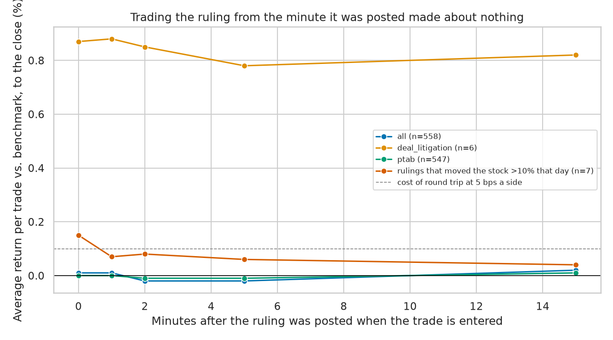

# Trading on a ruling in the minute after it was posted made 0.01% per trade, before costs

Written for Peter, to decide whether the 30-second ruling monitor is worth building.

- **What:** for 558 rulings from October 2024 to October 2026 that came out while the market was open, on a date nobody knew in advance, with a posting time and minute-by-minute prices, buy (if the ruling was good for the company) or short (if bad) at the first minute after posting, and sell at the close.
- **Result:** the trade made +0.01% per ruling before costs, and it was right 49% of the time. After an assumed 0.05% cost each way, it loses about 0.09% per ruling.
- **Limit:** 545 of the 558 rulings are patent-office (PTAB) decisions. The two big drug-patent rulings with known times, Pacira and Exelixis, came out before October 2024, outside the two years of minute prices, so this test says almost nothing about drug patents.

## PTAB: who won doesn't predict the price

After a PTAB ruling, the stock moved the way the outcome pointed, from the minute after posting to the close, 49% of the time, about what a coin toss would give. The same holds for the whole day: of the 437 trades with a full-day move, the stock moved the way the outcome pointed in 49% (an earlier draft said 38% because it counted the 121 trades with no full-day move as misses).

The likely reason, which I haven't tested: most of these rulings involve very large companies. 445 of the 552 PTAB trades are on the challenger's side, led by Alphabet (43), Apple (33), Microsoft (18) and AT&T (18). The median challenger was worth $113B, and one patent is a small part of that, so the day's move mostly comes from other news.

| Company's role in the PTAB case | Ruling | Trades | Right direction, entry to close | Average per trade |
|---|---|---|---|---|
| Challenger (petitioner) | good for it | 193 | 48% | −0.03% |
| Challenger (petitioner) | bad for it | 249 | 47% | −0.03% |
| Patent owner | good for it | 67 | 51% | +0.21% |
| Patent owner | bad for it | 40 | 57% | +0.15% |

Patent owners, median value $8B, do a little better. But 107 trades at about 0.2% each can't be told apart from zero at this sample size, and 0.2% is less than the trading cost a smaller company's stock is likely to carry (my estimate).

## Big moves: the price had already moved by the time we got in

Seven rulings were followed by a move of more than 10% on the day. The trade went the right way in six of them, and the median trade made 1.6% from entry to close. The seventh was Ford on May 13 2026: the ruling was bad for Ford, the stock rose 12.6% on the day, and the short lost 9.9%. Ford's move was probably other news (I haven't checked what), but a live system wouldn't know that at 9:46, when the ruling was posted.

## What this test can't tell us

- **Drug patents and merger challenges:** only 1 drug-patent ruling (Novartis, July 2025) and 2 merger rulings (Kroger and Albertsons, December 2024) fall inside the price window. These are the two case types where earlier work found large, fast moves.
- **Seconds:** minute bars can't show what happens in the first 30 seconds. "Entry at minute 0" uses the open of the first minute bar at or after the posting time, which is the closest these prices allow.
- **Costs:** the free bars have no bid and ask prices. The 0.05%, 0.25% and 0.5% costs each way are assumptions, not measurements. My estimate is that small-company spreads are often wider than 0.25%.
- **Posting times:** 550 of the 562 rulings have a posting minute, mostly from the patent office's system. 7 have only the hour, 3 only the date, and 2 use the minute the price jumped, which favours the trade.

## Conclusion

A fast PTAB monitor wouldn't pay on its own: across 545 trades the outcome didn't predict the price after posting. The case for a 30-second monitor now rests on drug-patent and merger rulings at small and mid-size companies, which this data can't test because the minute prices don't reach back to Pacira or Exelixis. Paid trade-by-trade data back to 2023, or waiting for the next such ruling with the monitor in alert-only mode, are the two ways to test it.

## Files

- `scripts/intraday_backtest.py` writes `data/universe/combined/intraday_backtest.csv`: one row per stock and ruling day, with the entry price at 0, 1, 2, 5 and 15 minutes after posting and the return to the close against XBI (drug patents) or SPY (everything else).
- `scripts/intraday_summary.py` writes `data/universe/combined/intraday_summary.csv`: results by case type, company size and size of the day's move.
- `scripts/intraday_chart.py` draws the chart above.
