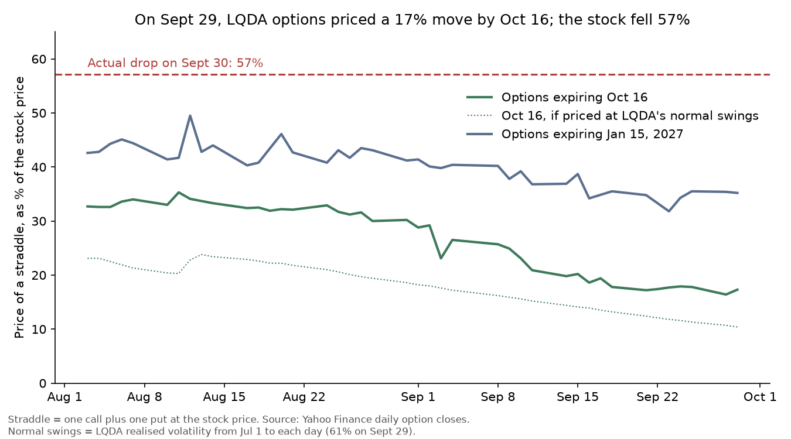
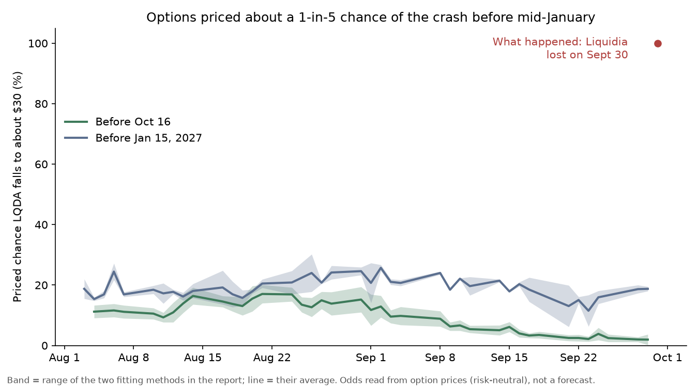

# What LQDA options priced before the Sept 30, 2026 patent ruling

Reader: someone who knows what a stock is but has never priced an option.

## Executive summary

- **What this is:** a reading of option prices on Liquidia (LQDA) and United Therapeutics (UTHR) in the weeks before Judge Richard G. Andrews ruled, on Sept 30, 2026, that Liquidia's YUTREPIA infringes claims 1 and 14 of United Therapeutics' U.S. Patent 11,826,327 (D. Del., No. 1:23-cv-00975; order D.I. 474 filed 11:15 ET, opinion D.I. 475 filed 11:21 ET). No ruling date had been announced.
- **Why it matters:** LQDA fell from $70.69 (Sept 29 close) to $30.26 (Sept 30 close), a 57% drop, and UTHR rose 12.5%. Option prices are bets with money behind them, so they show how likely traders treated that crash before it happened.
- **Where we looked:** daily closing prices of 793 LQDA and 233 UTHR option contracts from Yahoo Finance (Jul 1 to Oct 9, 2026) and daily contract counts from the Options Clearing Corporation (OCC). Free data only; no intraday option prices.
- **What we found:** on Sept 29, LQDA options priced a typical move of about 17% by Oct 16, against 10% for a normal stretch of LQDA trading. Read as odds, they gave roughly a 1-in-5 chance (18% to 20%) that LQDA would fall to about $30 before Jan 15, 2027, but only 0% to 4% for the 17 days to Oct 16. The crash came the next day.
- **Still open:** we cannot see option prices on the morning of Sept 30 (before 11:15 ET), the Sept 25 and Oct 2 weekly options have expired and are no longer served, and the UTHR numbers rest on too few trades to give reliable odds.

## Terms used

- **Option:** a contract to buy (a **call**) or sell (a **put**) 100 shares at a fixed price, the **strike**, until a fixed date, the **expiry**. A put is insurance against a drop: a $50 put pays $20 a share if the stock ends at $30.
- **Straddle:** buying a call and a put at the same strike, near the stock price. It pays off if the stock moves far in either direction, so its price, as a percent of the stock, is the market's price for "how far will this move by expiry".
- **Implied volatility (IV):** the yearly swing size that makes the standard option formula (Black-Scholes) give the traded price. 100% IV on a $70 stock means option buyers are paying for swings of about $70 over a year, or about $15 over 17 days.
- **Realised volatility:** the same swing size measured from the stock's actual daily moves. LQDA's was 61% from Jul 1 to Sept 29; UTHR's was 24%.
- **Term structure:** implied volatility listed by expiry date, nearest first.
- **Skew:** puts priced richer than calls the same distance from the stock price, which means buyers pay more for crash insurance than for upside.
- **Risk-neutral odds:** the odds you get by treating option prices as fair bets. They are not a forecast. People pay extra for insurance, so these odds usually run higher than what traders privately believe.

## 1. How big a move the options priced

**On Sept 29, the straddle for each expiry cost (as % of LQDA's $70.69):**
- Oct 9 (10 days): 14.1%. The traded $71 straddle was a $4.78 call plus a $5.49 put, $10.27 in all, or 14.5%.
- Oct 16 (17 days): 17.3%. LQDA's normal swings alone would price 10.4%.
- Nov 20 (52 days): 28.0%; the traded $70 straddle was 27.3%.
- Jan 15, 2027 (108 days): 35.2%.

**The actual drop was 57%,** about 3.3 times the Oct 16 straddle and 4 times the Oct 9 straddle. A straddle prices the average move, not the worst case, so a move several times the straddle is what a rare, large jump looks like.

**Implied volatility on Sept 29, by expiry:**
- Oct 9: 107%
- Oct 16: 100%
- Oct 23: 89%
- Oct 30: 98%
- Nov 20: 94%
- Jan 15, 2027: 82%
- Realised (actual swings, Jul 1 to Sept 29): 61%

**Every expiry was priced above LQDA's normal swings,** and the nearest ones the most. Traders were paying for some pending jump. With no announced date, they spread that jump over every expiry rather than piling it on one week.

**How it changed over September:**
- The Oct 16 straddle fell from 28.8% of the stock on Sept 1 to 17.3% on Sept 29. Most of that is time running out: at normal swings it would have fallen from 18.2% to 10.4% over the same days. (Normal swings for each day use only stock moves from Jul 1 up to that day.)
- Oct 16 implied volatility drifted from about 100% on Sept 1 down to 81% to 87% in mid-September, then back up to 92% to 93% (Sept 24 to 28) and 100% on Sept 29. The last-day rise is small and within the day-to-day noise of last-trade prices, so we do not read it as a leak.
- In early August the Oct 16 options also covered Liquidia's second-quarter results (LQDA fell 10.5% on Aug 12; earnings date unverified), which is part of why August straddles were higher.



## 2. What odds of a loss the options priced

**The plain version, from one put:** on Sept 29 the Oct 16 $50 put last traded at $0.49 (309 contracts that day). If Liquidia lost before Oct 16 and the stock went to about $30, that put would pay about $20. Paying $0.49 for a $20 payout is a 2.5% bet ($0.49 / $20). That is a ceiling on the priced odds, because the same put also pays on ordinary drops below $50. The put closed at $19.24 on Sept 30, about 39 times what it cost the day before.

**The same reading across expiries (most-traded put between $40 and $60, divided by its payout at $30.26):**
- Oct 9: $60 put at $1.02, at most 3.4%
- Oct 16: $50 put at $0.49, at most 2.5%
- Nov 20: $55 put at $3.20, at most 12.9%
- Jan 15, 2027: $55 put at $5.35, at most 21.6%

**The fuller version, a two-outcome model fitted to all traded options:** we assume that before each expiry, either the stock drops to $30.26 (with odds q) or it does not. If it does not, it ends at a "win" price set so the average of the two outcomes equals the stock's current price, which is how fairly priced bets must balance. Ordinary daily wobble sits on top of both outcomes. We then pick the q that best matches that day's traded out-of-the-money options (puts below the stock price, calls above it). We do it two ways:
- **Method A:** the size of the ordinary wobble is also fitted to the prices.
- **Method B:** the wobble is held at LQDA's own realised volatility, measured from Jul 1 up to that day (61% on Sept 29), so every dollar of option price above normal goes to the crash.

**Priced odds of a drop to about $30, on Sept 29 (Method A to Method B):**
- Before Oct 9: 1.0% to 3.5%
- Before Oct 16: 0.2% to 3.7%
- Before Nov 20: 6.3% to 11.0%
- Before Jan 15, 2027: 18.0% to 19.5%
- Before Mar 19, 2027: 17.4% to 20.5%

**Read as a rate, that is about 4% to 8% per month.** Method B gives 6.4% per 30 days from the Oct 16 options and 5.8% from the Jan 15 options, so short and long expiries agree. The model cannot tell "the ruling is coming soon" apart from "the ruling will go Liquidia's way"; it only prices the chance that both the ruling and the crash land before a given date.

**What a win was worth:** in the Jan 15 fit, the no-crash outcome is about $81.50, 15% above $70.69. So traders priced a lopsided bet: about +15% if Liquidia won and −57% if it lost.

**How much this depends on the $30 guess** (Jan 15 options, Sept 29, Method A to Method B):
- If a loss meant $25: 11.7% to 14.7%
- If a loss meant $30.26: 18.0% to 19.5%
- If a loss meant $35: 23.9% to 24.7%
- If a loss meant $40: 28.8% to 30.3%

**Over September, the priced odds did not rise into the ruling.** Before Jan 15 they ran between about 14% and 27% from day to day on Sept 1 to 4 and between 6% and 20% in the last week (Sept 21 to 29). Before Oct 16 they fell from 7% to 17% (Sept 1) to 0% to 4% (Sept 29), which is what shrinking time does to a fixed monthly rate.



## 3. Likely, unlikely, or fair?

**Unlikely for any given week, possible over a few months.** On the eve of the ruling, options gave at most about 1 in 27 (3.7%) for a crash before Oct 16 and about 1 in 5 before mid-January. The crash came the next morning.

**One event cannot show the odds were wrong.** A 1-in-5 outcome happens one time in five. What the prices do show:
- Traders knew something big was pending: near-term implied volatility was 100% against 61% realised, and the Oct 16 straddle was 17.3% against 10.4% at normal swings.
- They did not treat late September as the likely week, and the priced odds did not climb in the final days.
- Cheap near-dated crash insurance paid 28 to 39 times its cost: the Oct 16 $50 put went from $0.49 to $19.24, and the Oct 9 $60 put from $1.02 to $28.40.
- Because risk-neutral odds usually run above traders' private beliefs, the crowd's real view of a near-term loss was probably even lower than these numbers.

**Daily trading volume showed no rush into puts.** OCC counts for Sept 29: 3,395 LQDA put contracts and 7,569 calls, against a pre-ruling September average of 7,724 puts and 7,374 calls a day. On Sept 30 volume jumped to 22,792 puts and 31,168 calls, but the OCC total covers the whole day, so it cannot be split into before and after 11:15 ET.

## 4. UTHR, the other side of the case

**UTHR options also priced a pending jump, but a small one.** On Sept 29 the Oct 16 straddle cost 6.0% of UTHR's $481.47, against 4.1% at UTHR's normal swings (realised 24%; Oct 16 implied volatility 35%). The actual move was +12.5%, about twice the straddle.

**We do not report UTHR odds.** On most days only 2 to 11 out-of-the-money UTHR contracts traded, the two-outcome fit matched them poorly, and the estimates jumped between 11% and 37% from one day to the next.

**Two large packages traded before the ruling** (Oct 16 expiry, each about 8,300 contracts, in OCC data between a customer and a firm on NYSE American):
- Sept 18: $570 calls (8,335), $540 calls (8,315) and $460 puts (8,300).
- Sept 29, the day before the ruling: $540 calls (8,300 at $1.50) and $430 puts (8,312 at $2.25).

The daily data cannot show who bought and who sold. One common reason for a call-and-put package of matching size is a large UTHR shareholder rolling a hedge, but that is a guess (unverified). Whoever held the $540 calls from $1.50 held contracts worth at least $31.38 each at the Oct 1 close ($571.38 minus $540), about $25 million across 8,300 contracts.

## Data limits

- **Last trade, not quotes.** Yahoo's daily close for an option is its last trade of the day, which can be hours older than the 4 pm stock price. There are no bid or ask prices. We drop any contract with zero volume that day and use out-of-the-money contracts, which go stale less.
- **Missing contracts.** Yahoo no longer serves expired contracts, so the Sept 25 and Oct 2 weeklies, the nearest expiries before the ruling, are missing. The Oct 9 weekly was listed on Aug 31 and is included.
- **Strike lists were found by trying every strike** ($0.50 steps for LQDA, $5 steps for UTHR) on each expiry.
- **Assumptions:** 4% interest rate, no dividends, and a loss price of $30.26, which is hindsight; the sensitivity list above shows how much it matters.
- **No intraday option data** is available free, so the 11:15 ET filing minute cannot be checked against option trades.

## Files and how to rerun

- `fetch_options.py`: downloads `stock_daily.csv`, `option_daily.csv` and `occ_volume.csv`. None of the three files is in the repo. Yahoo stops serving a contract once it expires, so the October 2026 contracts can no longer be downloaded and `implied.py` can't be rerun in full from a fresh clone. Its outputs are kept here (about 10,000 requests, cached in `~/work/lawsuit/cache`).
- `implied.py`: writes `implied_by_day.csv` (one row per day and expiry), `loss_price_sensitivity.csv` and the two charts.

```
pip install pandas numpy scipy matplotlib requests
python3 options/fetch_options.py
python3 options/implied.py
```

## Sources

- Yahoo Finance chart API, example contract: https://query1.finance.yahoo.com/v8/finance/chart/LQDA261016P00050000?interval=1d&range=3mo
- OCC daily volume, example: https://marketdata.theocc.com/volume-query?reportDate=20260929&format=csv&volumeQueryType=O&symbolType=U&symbol=LQDA&reportType=D&accountType=ALL&productKind=ALL&porc=BOTH
- Court docket search, United Therapeutics v. Liquidia, No. 1:23-cv-00975 (D. Del.), RECAP archive: https://www.courtlistener.com/?q=%2223-cv-00975%22 (docket entry times as given in the task brief; not rechecked here)
